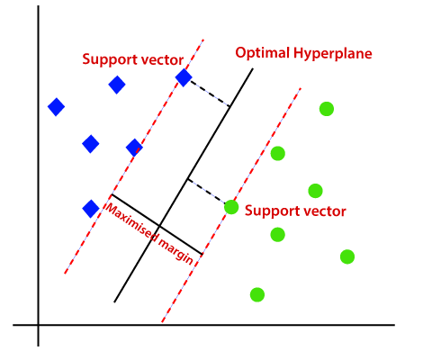
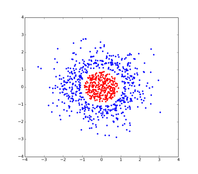
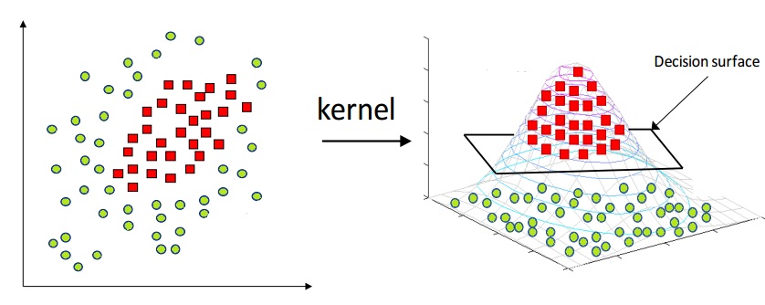
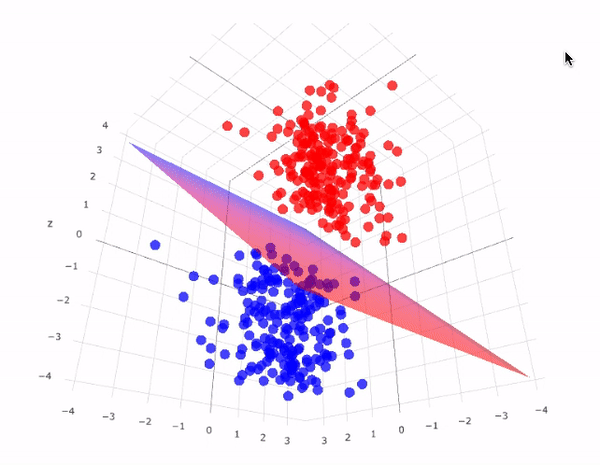
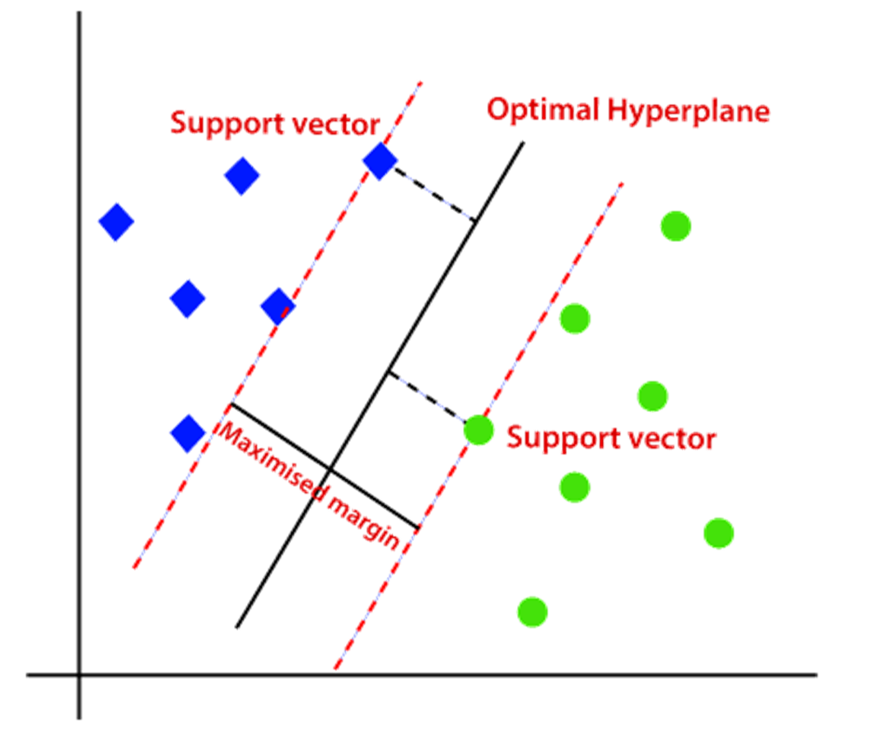
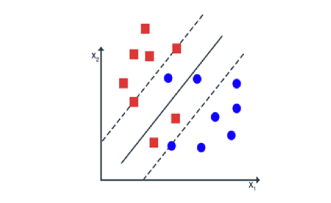
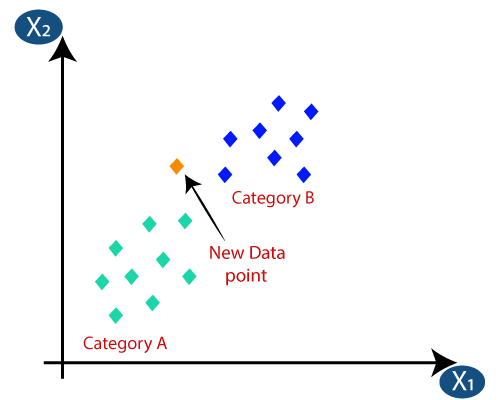

# SVM and KNN

## Slide 1

SVM and KNN

## Slide 2

Support Vector Machine (SVM)

## Slide 3

Support Vector Machines

Definition: Support Vector Machine (SVM) is a supervised learning algorithm that finds the hyperplane which best separates the data into different classes.
It can both be used for classification or regression.
Objective: To maximize the margin between the data points of different classes.

## Slide 4

Support Vector Machines

Terminology:
Hyperplane: A decision boundary that separates data points of one class from another.
Margin: The distance between the hyperplane and the closest data points from each class.
Support Vectors: Data points that lie closest to the hyperplane and influence its position and orientation.

## Slide 5

Margins in SVM

## Slide 6

BASIC SVC Model

When the data is linearly separable, SVM finds a linear hyperplane that maximizes the margin.

## Slide 7

Real World Scenario

However in real world scenario, the data is not often linearly separable.

## Slide 8

Handling Non Linear Data

Non-linear data refers to data with intricate, non-linear relationships between features and classes.
The kernel trick is a technique to address non-linearity, often used with SVM, transforming data into higher-dimensional spaces.
Linear classifiers, like SVM, struggle with non-linear data.
This technique enhances SVM's versatility by allowing it to establish non-linear decision boundaries for complex data distributions in classification tasks.

## Slide 9

Kernel Trick

To make the non linear data separable, kernel trick is used.
This means that converting the original features to higher dimensions.

## Slide 10

Kernel Trick

## Slide 11

Kernel Functions

Kernel functions are mathematical functions used in SVM to transform input data into a higher-dimensional feature space.
Polynomial kernels capture polynomial relationships, allowing SVM to model curved decision boundaries.
Radial basis function (RBF) kernels create flexible, non-linear decision boundaries, suitable for complex data distributions.
Kernels enable SVM to work effectively in high-dimensional spaces, simplifying classification by projecting data into spaces where classes are more separable.

## Slide 12

Soft Margin Classifier

Apart from kernel trick, another common way to handle non linear data is the soft margin classifier.
Until now, we have the concept of maximum margin classifier which is also know as hard margin classifier.

## Slide 13

Soft Margin Classifier

The soft margin classifier is an extension of the Support Vector Machine (SVM) that helps deal with cases where data is not perfectly linearly separable. 
It introduces a way to allow some misclassifications while still finding a good decision boundary. 
What is a Soft Margin Classifier?
In a traditional (hard margin) SVM, the goal is to find a hyperplane that perfectly separates the data into different classes with the largest possible margin. 
However, this can be too strict, especially when:
Data is noisy: Some noise is present in the data.
Data is not perfectly separable: Classes might overlap or be close to each other.
The soft margin classifier relaxes the strict requirement of perfect separation and allows some data points to be on the wrong side of the hyperplane. 
This makes the model more flexible in handling real-world data.

## Slide 14

Soft Margin Classifier

## Slide 15

Margin vs Soft Margin

Margin: The distance between the hyperplane (decision boundary) and the nearest data points from each class. For a perfect hard margin classifier, these points are strictly outside the margin and classified correctly.
Soft Margin: In the soft margin classifier, the model allows some data points to be within or even on the wrong side of the margin. This is done to handle cases where the data is not linearly separable or has noise.
Criteria:
Points outside the margin - Correctly classified and at least one margin distance away from the hyperplane.
Points within the margin - Correctly classified but closer to the hyperplane, within the margin region.
Points on the wrong side of the hyperplane - Misclassified, with slack variables reflecting their violation of the margin constraints.

## Slide 16

Bias and Variance Tradeoff

The bias-variance trade-off is a fundamental concept in machine learning, describing the balance between:
Bias: Error due to overly simplistic assumptions in the model (e.g., assuming a linear boundary when the data is not linearly separable).
Variance: Error due to excessive complexity in the model, leading to overfitting on the training data.

## Slide 17

Soft Margin and Bias Variance Tradeoff

C is a regularization parameter that controls the trade-off between maximizing the margin and minimizing the slack variables.
High C:
- Effect: The model places more emphasis on minimizing misclassifications, leading to a smaller margin and allowing more slack variables.
- Impact on Bias: Lower bias since the model fits the training data more closely.
- Impact on Variance: Higher variance because the model might overfit the training data, capturing noise as if it were a significant pattern.
Low C:
- Effect: The model focuses more on maximizing the margin, even if it means accepting some misclassifications.
- Impact on Bias: Higher bias because the model may be too simple and may not capture the complexity of the data.
- Impact on Variance: Lower variance since the model is less sensitive to the specific training data, making it more generalizable.
Cross validation must be used to determine the appropriate value of C.

## Slide 18

Hyperplane

In case of 1D data, the hyperplane is a point.
In case of 2D data, the hyperplane is a line.
In case of 3D data, the hyperplane is a plane.

## Slide 19

Parametric vs Non Parametric Models

## Slide 20

Parametric Models

Parametric models are a class of statistical models that assume a specific form or structure for the underlying data distribution, characterized by a fixed number of parameters. 
These models rely on predefined assumptions about the functional form of the relationship between variables, such as linear relationships in linear regression. 
By having a fixed number of parameters, parametric models are often simpler and faster to compute and interpret, making them efficient for well-understood data patterns. 
However, their rigidity can limit their ability to capture complex relationships in the data. 
Examples include linear regression and logistic regression.

## Slide 21

Non-parametric models 

Non-parametric models are a class of statistical models that do not assume a fixed form or a predetermined number of parameters for the underlying data distribution. 
Instead, these models are flexible and adapt their complexity based on the data itself, making them suitable for capturing intricate patterns without assuming a specific functional form. 
Examples include K-Nearest Neighbors (KNN) and decision trees. 

## Slide 22

Parametric Vs Non Parametric Models

| Parametric Models | Non-Parametric Models |
| --- | --- |
| Fixed Structure: Assume a specific form or structure for the model (e.g., linear regression). | Flexible Structure: No fixed form; adapts to the data as needed (e.g., K-Nearest Neighbors). |
| Fixed Number of Parameters: The number of parameters is predetermined and does not change with data size. | Variable Number of Parameters: The number of parameters or complexity can grow with more data. |
| Assumes Data Distribution: Based on assumptions about the data distribution. | Data-Driven: Adapts directly to the data without making strong assumptions about distribution. |
| Simpler and Faster: Often easier to compute and interpret. | More Complex: Can be computationally intensive and harder to interpret but more flexible. |
| Less Flexible: May struggle with complex patterns in the data. | More Flexible: Better at capturing intricate patterns and relationships in the data. |

## Slide 23

Parametric vs Non Parametric Models

- Random Forest (RF): Non-parametric – Uses an ensemble of decision trees and does not assume a specific functional form.
- Decision Tree (DT): Non-parametric – Makes decisions based on splitting data at various levels, with no fixed form or number of parameters.
- Linear Regression (Reg): Parametric – Assumes a linear relationship between input and output with a fixed number of parameters.
- Logistic Regression: Parametric – Models the probability of a binary outcome using a logistic function with a fixed number of parameters.
- Support Vector Machine (SVM): Parametric (when using linear kernel) / Non-parametric (when using non-linear kernels like RBF) – Linear SVM is parametric, but non-linear kernels allow flexible, complex boundaries.

## Slide 24

Parametric vs Non Parametric Models

- K-Nearest Neighbors (KNN): Non-parametric – Makes predictions based on the local proximity of data points without assuming a specific form.
- Naive Bayes: Parametric – Assumes a specific probabilistic model based on feature independence with a fixed number of parameters.

## Slide 25

KNearestNeighbours (KNN)

## Slide 26

KNN

K-Nearest Neighbors (KNN) is a simple yet powerful supervised learning algorithm used for both classification and regression tasks. 
It operates on the principle that similar data points are likely to be close to each other in feature space. 
What is K-Nearest Neighbors?
Definition: KNN is a non-parametric, instance-based learning algorithm that classifies or predicts the value of a data point based on the values of its nearest neighbors in the feature space.
Instance-Based Learning: The model does not explicitly learn a function from the training data but makes predictions based on the stored training examples.

## Slide 27

KNN

## Slide 28

KNN

Key Terminology:
K: The number of nearest neighbors to consider when making a prediction. It is a user-defined parameter.
Distance Metric: The method used to calculate the distance between data points. Common distance metrics include Euclidean distance, Manhattan distance, and Minkowski distance.
Neighbors: The K data points in the training set that are closest to a given test data point.

## Slide 29

KNN

How KNN Works:
- Training Phase: Store all training examples in memory. There is no explicit training phase as KNN is a lazy learner.
- Prediction Phase:
  - For Classification:
    - Find the K nearest neighbors to the test point using a chosen distance metric.
    - Assign the class label that is most common among these K neighbors (majority voting).
  - For Regression:
    - Find the K nearest neighbors to the test point.
    - Predict the value as the average (or weighted average) of the values of these K neighbors.

## Slide 30

KNN Algorithm Steps

- Select the Number of Neighbors (k): Choose the value of k, the number of nearest neighbors to consider.
- Calculate Distances: Compute the distance between the data point to classify and all other data points.
- Identify Nearest Neighbors: Choose the k data points with the shortest distances as the nearest neighbors.
- Majority Voting (Classification): In classification, predict the class based on the majority class of the nearest neighbors.
- Average (Regression): In regression, predict the target value by averaging the values of the nearest neighbors.

## Slide 31

Distance Metrics

- Measure Similarity: Quantify the dissimilarity between data points.
- Euclidean Distance: Straight-line distance in space.
- Manhattan Distance: Sum of absolute differences.
- Minkowski Distance: Generalized metric based on parameter p.
Distance metrics gauge data similarity and are essential for clustering and classification algorithms.

## Slide 32

Selecting the Value of K

The number of nearest neighbors (K) is crucial.
Small K:
    - Low bias, high variance.
    - Prone to overfitting.
Large K:
    - High bias, low variance.
    - Smoother but may underfit.
Optimal K: Found through cross-validation.
Impact: K affects bias and variance.
Trade-offs: Balance is needed for a well-generalized model.

## Slide 33

Thank You
