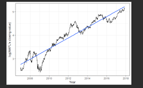
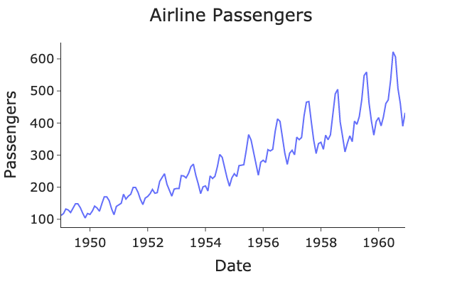
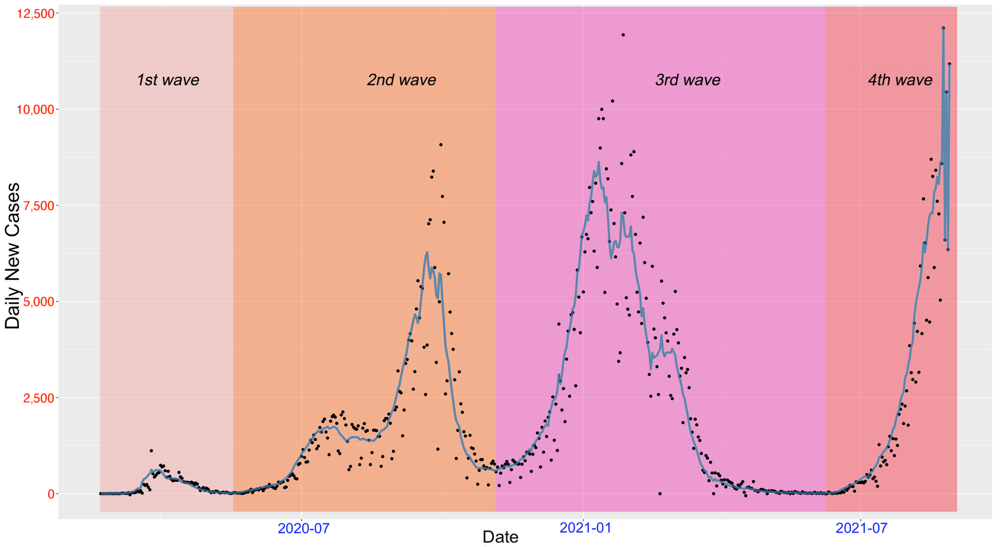
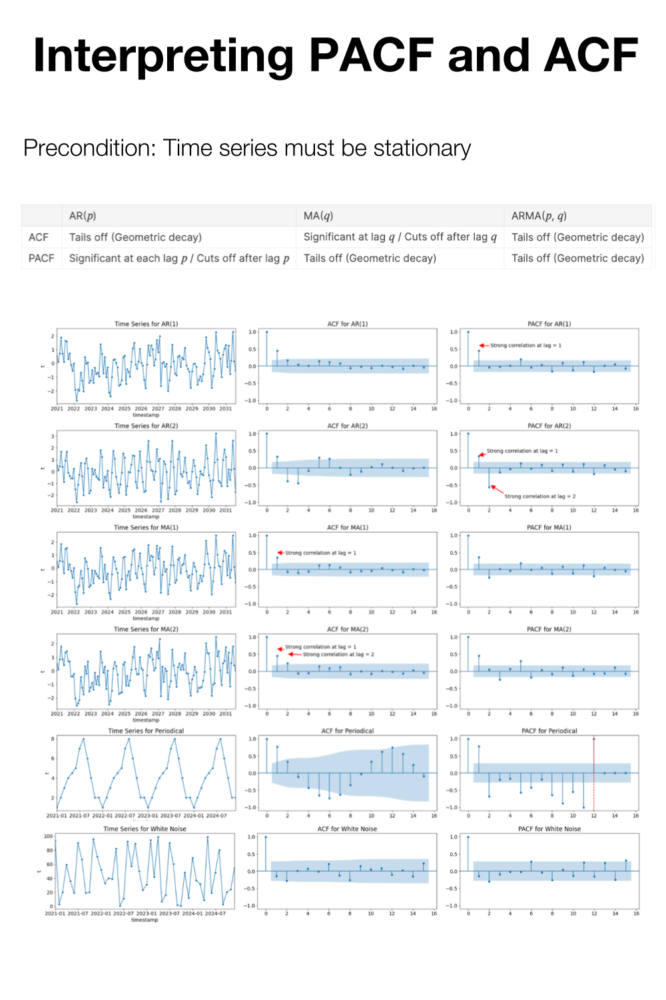

## Introduction to Time Series

Time series data is a sequence of data points observed at fixed time intervals for example per minute, hourly, daily, weekly, monthly, yearly, etc.  
Common characteristics of time series are:
  - Sequential data points ordered by time.
  - Often exhibits trends, seasonal patterns, or cycles.
  - Can contain irregularities or outliers.

## Real WORLD APPLICATIONS

- Stock Market Analysis
- Crypto
- Forex
- Energy Consumption
- Climate and Weather Forecasting
- Economic Forecasting
- Supply Chain Management
- Demand Forecasting
- Pandemic Outbreak
- Rain Prediction
- Flood Prediction

## Practical implications of time series ANALYSIS

Time series analysis is a predictive modeling tool that aids in making well-informed decisions.  
For example, if an investor knows the closing price of a particular stock for tomorrow, they can make well-informed buy or sell decisions.  
Similarly, if a manufacturing company can predict sales for the next quarter, they can plan their resources accordingly, ensuring no stock outs or excessive inventory.  
Moreover, if the disaster management department can accurately predict rainfall for the coming year, they can prepare for potential floods.

## TRENDS

Long-term directional movements in the data.  
Can be upwards or downwards  
Indicates overall growth or decline.  
May be linear or nonlinear.  
Can help in understanding underlying changes over time.  
Presence of trend in time series make it non stationary.

## SEASONALITY

Regular, repeating patterns in data.  
Occurs at consistent intervals (daily, weekly, etc..).  
Influenced by external factors like weather or holidays.  
Can be observed as peaks and troughs in the data.
  - Power consumption data shows daily seasonality
  - Ice-cream purchase data shows yearly seasonality

## CYCLES

Longer-term fluctuations in data.  
Not as regular as seasonal patterns.  
May exhibit irregular durations and amplitudes.
  - For example: COVID 19 data.

**Speaker notes:**

https://www.amazon.com/Time-Analysis-Forecasting-George-Box/dp/0470272848  
Time Series Analysis: Forecasting and Control 4th Edition

## Conditions of stationarity

Constant Mean - The mean of the series remains constant over time.  
Constant Variance - The variance (or standard deviation) of the series remains constant over time.  
Constant Autocorrelation - The autocorrelation between two observations at different time points remains constant over time.  
No Trend - There is no systematic trend or pattern in the data, meaning the series does not exhibit long-term upward or downward movements.  
No Seasonality - The series does not exhibit periodic fluctuations at fixed intervals.  
Tests such as Augmented Ducky Fuller (ADF) Test are used to check stationarity.

## TIMESEREIS Forecasting methods

Statistical forecasting (AR, MA, ARIMA, ARMA, SARIMA, ARMAX, ARIMAX, SARIMAX, ARCH, GARCH, etc..)  
Machine learning models (RFR, SVR, DTR, etc.)  
Deep learning models (RNN, GRU, LSTM, ID CNN)  
Transformers: Autoformer, Informer, etc

## Autoregressive Integrated Moving Average (ARIMA)

The Autoregressive Integrated Moving Average (ARIMA) model is comprised of 3 major parts
  - Autoregressive (AR)
  - Integrated (I)
  - Moving Average (MA)

## Autoregressive (AR) Component

Represents the regression of the current value of a time series on its past values.  
Each observation in the series is modeled as a linear combination of its lagged (past) values.  
AR(p) model, where 'p' denotes the order of the autoregressive process, uses 'p' lagged values to predict the current value.  
The model equation for AR(p) can be represented as:  
yt​=c+ϕ1​yt−1​+ϕ2​yt−2​+…+ϕp​yt−p​+εt​  
Where, yt​ is the current observation, c is a constant, ϕ1​,ϕ2​,…,ϕp​ are the autoregressive coefficients yt−1​,yt−2​,…,yt−p​ are the lagged values, and εt​ is the error term at time t.

The AR component in ARIMA models captures how a current value in a time series depends on its past values.
- Modeling Past Values: It models this dependence through linear regression against its lagged (past) values. The order 'p' determines how many past values are considered.
- Example: In ARIMA(2, 0, 0), 'p' is 2, meaning it considers the influence of the two immediate previous values on the current value.
- Interpretation: Higher 'p' values indicate a longer memory of past values, capturing more complex and longer-term patterns in the time series.

## Integrated (I) Component

Represents the differencing of the time series data to achieve stationarity.  
It involves computing the difference between consecutive observations to remove trends.  
The order of integration 'd' indicates how many times differencing is required to make the series stationary.  
The differenced series is denoted as Δyt​, where yt​ represents the original time series.

Differencing is a process of subtracting a previous time point from the current one in a time series.  
Role in Stationarity: Differencing helps make a time series stationary by removing trends and seasonality, ensuring that statistical properties remain constant.  
Order 'd': The 'd' parameter in ARIMA specifies how many differences are needed to achieve stationarity. It can be first-order (d=1), second-order (d=2), and so on.

## Moving Average (MA) Component

Represents the dependency of the current value of a time series on the past prediction errors (residuals).  
Each observation in the series is modeled as a linear combination of past forecast errors.  
MA(q) model, where 'q' denotes the order of the moving average process, uses 'q' lagged forecast errors to predict the current value.  
The model equation for MA(q) can be represented as:  
yt​=c+εt​+θ1​εt−1​+θ2εt−2​​+…+θq​εt−q​  
where yt​ is the current observation, c is a constant, εt​ is the error term at time t, θ1​,θ2​,…,θq​ are the moving average coefficients, and εt−1​,εt−2​,…,εt−q​ are the lagged forecast errors.

The MA component models the relationship between the current value in a time series and past forecast errors, or white noise.  
Modeling Past Errors: MA uses past error terms to adjust the current value. It captures the short-term dependencies between observations by considering how past forecast errors influence the present value.  
Order 'q': The 'q' parameter in ARIMA specifies the number of past error terms used in the model. It can be first-order (q=1), second-order (q=2), and so on.

## Interpretation of arima models

ARIMA(2,1,3) 	p,d,q  
ARIMA(0,1,1)  
ARIMA(1,0,1) =ARMA(1,1)  
ARIMA(1,0,2) = ARMA(1,2)  
ARIMA(1,0,0)  =AR(1) model  
ARIMA(0,0,2)  =MA(2)  
PACF = p  
ACF = q

## ARMA

ARMA means Auto Regressive Moving Average.  
This is similar to ARIMA, the only difference is that the words “integrated” is missing which takes care of the differentiation to make the time series stationary.  
This means that ARMA considers the time series to be already stationary.  
In other words, ARIMA becomes ARMA in case the time series is already stationary.
  - Hence, we will be using ARIMA and ARMA interchangeably.

## Building ARIMA Models

Building ARIMA Models:
  - Data Preparation: Collect and preprocess data, ensuring stationarity.
  - Differencing (I): Make data stationary through differencing (d).
  - Auto-Regression (AR): Determine order p using PACF.
  - Moving Average (MA): Find order q using ACF.
  - Model Selection: Use AIC or BIC for best model choice.
  - Model Fitting: Fit ARIMA to data.
  - Model Evaluation: Use tests and plots for model validation.
  - Forecasting: Make predictions.

Model Selection and Order Determination:
  - p (AR Order): PACF plot lag where it cuts off.
  - q (MA Order): ACF plot lag where it cuts off.
  - d (Differencing Order): Augmented Dickey Fuller (ADF).
  - Criteria: Lower AIC/BIC for better models.
  - Grid Search: Explore combinations.
  - Cross-validation: Ensure generalization.
  - Autoarima does the grid search.

## Flow Chart - ARIMA Models

Start

Data Preparation

Collect and Preprocess Data

Differencing (I)

Make Data Stationary

Determine 'd' (Differencing Order)

Model Components

Auto Regressive (AR)

Moving Average (MA)

Identify 'p' (AR Order) from PACF

Identify 'q' (MA Order) from ACF

Model Selection

Model Building

Model Evaluation

Forecasting

Ensure Stationarity

Evaluate AIC/BIC for Model Choice

Perform Grid Search

Cross-Validation

Fit ARIMA Model

Use Tests and Plots for Validation

Make Predictions 

## Seasonal ARIMA (SARIMA)

- SARIMA Components: SARIMA combines Seasonal Auto-regression (P), Seasonal Differencing (D), and Seasonal Moving Average (Q) with the standard ARIMA model.
- Seasonal Auto-regression (P): Captures how current values depend on past values within the same season.
- Seasonal Differencing (D): Stabilizes seasonal patterns by differencing values from the same season in the previous cycle.
- Seasonal Moving Average (Q): Uses past seasonal errors to predict future values.
- Seasonal Period (s): Specifies the number of time steps in each seasonal cycle.
- Applications: SARIMA is used for accurate forecasting of time series data with clear seasonal patterns, such as monthly sales, quarterly financial reports, or yearly weather data. It models both non-seasonal and seasonal components.

## Seasonal Auto-Regression

SAR represents the seasonal auto-regression component in SARIMA.
- Handling Seasonality: Seasonal patterns in time series data often occur at regular intervals (e.g., daily, weekly, monthly). SAR models how the current value of a time series depends on past values within the same season (i.e., previous seasonal cycles).
- Parameter (P): The order of the seasonal auto-regression component, denoted as "P," specifies how many past seasonal observations are considered for prediction.
- Use Case: SAR helps capture and model recurring patterns, making SARIMA effective for data with both seasonal and non-seasonal variations, such as monthly sales data influenced by annual trends or daily temperature data with a yearly cycle.

## Seasonal Differencing (SI)

- Seasonal Differencing (SI): A key element of SARIMA models to address seasonality.
- Purpose: To make the data stationary by removing seasonal patterns.
- Parameter (D): Represents the number of seasonal differences applied.
- Use Case: Necessary when dealing with data that exhibits seasonality over time (e.g., monthly or yearly trends).

## Seasonal Moving Average (SMA)

- Seasonal Moving Average (SMA): A vital part of SARIMA models to manage seasonality.
- Purpose: To model and capture seasonal variations or errors.
- Parameter (s): Represents the number of seasonal periods in each season.
- Use Case: Necessary when dealing with time series data that exhibits seasonal patterns, such as sales data with yearly or quarterly seasonality.

## Building and Forecasting with SARIMA

- Data Prep: Start with seasonal time series data and make it stationary if needed.
- Identify Seasonality: Find the seasonal period, like 12 for monthly data.
- Model Identification: Use ACF and PACF plots to identify SAR, SI, and SMA orders.
- Model Selection: Choose the best SARIMA model based on AIC and BIC values.
- Model Fitting: Use software like Python's statsmodels to fit the SARIMA model.
- Forecasting: Generate future forecasts for a specified number of periods.
- Visualize: Plot forecasts with confidence intervals to understand future trends.
- Evaluation: Assess model performance with metrics like RMSE.

## Evaluation Techniques: ARIMA & SARIMA

- Visual Inspection: Examine plots of observed vs. predicted data for model fit assessment.
- Residual Analysis: Analyze residuals to ensure they are random and independent.
- Out-of-Sample Testing: Split data into training and testing sets for assessing model performance on unseen data.
- Cross-Validation: Implement techniques like k-fold cross-validation to validate model generalization.

## Common Evaluation Metrics

- RMSE (Root Mean Squared Error): Measures the average error magnitude.
- MAE (Mean Absolute Error): Quantifies the average absolute forecasting error.
- MAPE (Mean Absolute Percentage Error): Computes percentage error relative to actual values.
- AIC and BIC: Information criteria balancing model fit and complexity (lower values are better).
- R-squared (R²): Shows the proportion of data variance explained by the model.

## Model Tuning

Model Tuning for ARIMA and SARIMA:
  - Adjust Orders: Modify model orders (p, d, q) and seasonal orders (P, D, Q, s) based on data characteristics and diagnostics.
  - Grid Search: Systematically explore different hyperparameter combinations.
  - Automated Tools: Use libraries like 'pmdarima' for automated hyperparameter selection.
  - Manual Refinement: Iteratively fine-tune the model based on performance feedback.

Hyperparameter Optimization:
  - Grid and Random Search: Explore hyperparameter space with predefined ranges.
  - Bayesian Optimization: Utilize Bayesian methods for efficient optimization.
  - Cross-Validation: Validate hyperparameter choices with cross-validation.
  - Objective Metrics: Define evaluation metrics (e.g., AIC, BIC, RMSE) to guide optimization.

## White Noise

The basic conditions for white noise are:  
Zero Mean: The average value of the white noise series should be zero.  
Constant Variance: The variance of the white noise series should be constant over time.  
Independence: Each value in the white noise series should be statistically independent of all other values.  
No Autocorrelation: There should be no correlation between the values at different time points; the autocorrelation function should be zero for all lags except at lag zero.  
ACF and PACF on a higher level can tell about the independence and the autocorrelation however while in depth analysis we have to conduct various statistical tests.

## Homoscedasticity and heteroscedasticity

Homoscedasticity refers to a situation where the variance of errors or residuals in a dataset is constant across all levels of an independent variable, meaning the spread of errors remains consistent regardless of the value of the predictor.  
In contrast, heteroscedasticity occurs when the variance of errors changes with the level of the independent variable, resulting in a spread of residuals that varies across different values of the predictor. This can indicate that the model may not be capturing some underlying patterns in the data, potentially leading to unreliable statistical inferences.

## ARIMA Steps by Box and Jenkins

It is comprised on 4 steps:  
1. lags determination  
    a. Check for stationarity (d) by timeseries plot and ADF test  
    b. determine p  
    c. determine q  
If the model is stationary, it means that I=0 i.e. ARIMA will become ARMA.  
2. Estimate the model parameters by fitting ARIMA or ARMA.  
3. Calculate the residuals (errors).We need to prove that the residuals are a white noise by checking the following 3 conditions. This is also termed as diagnostic checking.  
    a. Mean = 0  
    b. Variance = constant  
    c.  conditional heteroscedasticity = 0 (by ARCH test)  
4. Forecasting. We can go to forecast only if the above 3 conditions are fulfilled else we will have to go with the ARCH or the GARCH models.

## Diagnostic checking

After applying ARIMA models, diagnostic checking involves the following steps:  
Check Residuals: Ensure the residuals (errors) are white noise  
Ljung-Box Test: Perform this test to check if the residuals are independently distributed. A high p-value suggests no significant autocorrelation.  
Normality Test: Test if the residuals follow a normal distribution.  
Heteroscedasticity Test: Check for changing variance in residuals by examining residual plots.  
Parameter Significance: Verify that the estimated model parameters are statistically significant and not zero.

## ARCH and GARCH

VOLITALITY  
Volatility is a measure of how much the price of an asset, like a stock, fluctuates over time.  
If an asset's price changes frequently and by large amounts, it is considered highly volatile.  
Conversely, if the price changes slowly and steadily, it is considered less volatile.  
In essence, volatility represents the degree of uncertainty or risk associated with the price changes of an asset.  
Volatility is directly related to the variance of the errors in a time series, as it measures how much these errors (or deviations from predicted values) vary over time. Higher variance in the errors indicates greater volatility, meaning the asset's price experiences larger and more frequent fluctuations.

ARCH (Autoregressive Conditional Heteroskedasticity) and GARCH (Generalized Autoregressive Conditional Heteroskedasticity) are advanced statistical models used to understand and forecast the volatility of time series data, which is particularly useful in financial markets.  
These models extend the concept of ARIMA (Autoregressive Integrated Moving Average) and SARIMA (Seasonal Autoregressive Integrated Moving Average), which are primarily designed to model and forecast the actual values of a time series.

While ARIMA and SARIMA focus on capturing the underlying patterns and trends in time series data to predict future values, ARCH and GARCH are concerned with modeling the variability or volatility of these values.  
The key insight behind ARCH models is that the variance of a time series is not constant over time but varies depending on past observations.  
This is particularly relevant for financial time series, where periods of high volatility are often followed by more high volatility, and periods of low volatility are followed by more low volatility.

ARCH models account for this changing variance by modeling the variance of the current error term as a function of the past error terms.  
This means that the model adapts to changes in volatility over time.

## ARCH AND GARCH – REAL WORLD USES

Both ARCH and GARCH models are especially useful in risk management, option pricing, and financial forecasting.  
They are used to estimate how much the variability of asset returns is likely to fluctuate, which is crucial for investors and analysts to make informed decisions.  
While these models do not predict the actual future values of a time series, they provide valuable forecasts of volatility, which can be critical for understanding market behavior and for constructing strategies that account for varying levels of risk.

## ARCH AND GARCH STEPS

1. Apply ARIMA Model:  
Fit the ARIMA model to your time series data.  
Check the residuals from the ARIMA model for patterns or heteroscedasticity (non-constant variance).  
2. Evaluate ARIMA Performance:  
Assess model diagnostics to determine if the ARIMA model is adequately capturing the data's patterns.  
Look for issues like check for whether if the residuals are Homoscedasticity and heteroscedasticity .  
3. Reiterate ARIMA in case the model fails to pass the diagnostic check.

4. Apply ARCH Model:  
If the model does not pass the diagnostic test irrespective of the commination that we use in ARIMA models then go for ARCH model.  
Fit an ARCH model to the residuals from the ARIMA model to model the changing variance.  
Select the appropriate ARCH order based on model selection criteria or diagnostic checks.  
5. Generate Forecasts from ARCH Model:  
Produce forecasts of the variance from the ARCH model, which will give you estimates of future volatility.

6. Combine Forecasts:  
Use the ARIMA forecasts for the mean level of the time series.  
Incorporate the ARCH forecasts to adjust for expected volatility in the future.  
Combine both forecasts to get the final predictions, often by adjusting the ARIMA forecasts for the volatility predicted by the ARCH model.  
7. Evaluate Combined Forecasts:  
Compare the final forecasts with actual outcomes to evaluate the accuracy and effectiveness of the combined approach.  
Refine models as necessary based on performance and accuracy.
